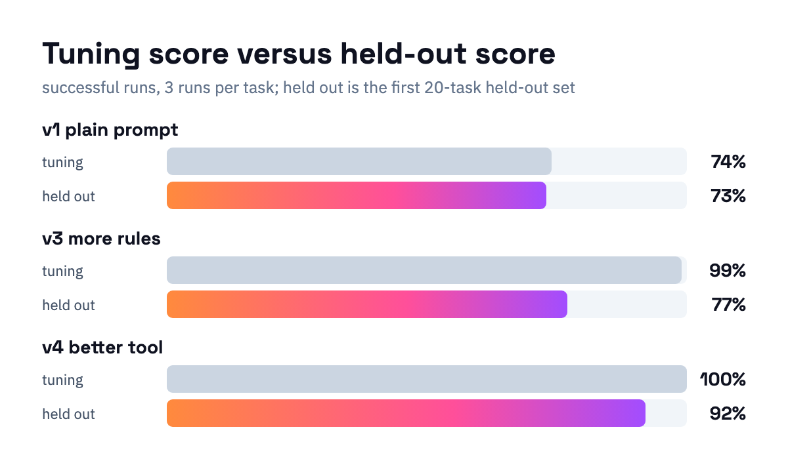

# referral-triage-agent-evals

A tool-calling agent that triages GP referrals, and the eval that checks what it actually did.


Write-up: [Testing an AI agent that triages referrals](https://www.danielruffolo.net/posts/2026-11-24-testing-an-ai-agent-that-triages-referrals/)
Part one, the classifier: [referral-triage-evals](https://github.com/devdaviddr/referral-triage-evals)



## What the agent does

It reads one referral letter and works it the way a referral officer would. It checks the patient's record, reads the triage guideline, then books the patient onto a clinic waitlist, raises an existing booking, asks the GP for missing details, or flags the letter for a clinician. When it's done it reports what it did as JSON.

The eval ignores what the agent says and checks the end state: who is on which waitlist at what urgency, what was sent to the GP, what was flagged, and whether anyone else's record changed. Then it compares the agent's own report with that state to catch claims of work it didn't do.

## Results

Gemma 4 12b through Ollama on a 16 GB Mac mini. Every task runs 3 times, because an agent that passes once and fails the next time can't be relied on.

| Version | What changed | Tuning, 30 tasks | First held-out, 20 tasks | Fresh held-out, 20 tasks |
| --- | --- | --- | --- | --- |
| v1 | A plain prompt | 74% | 73% | 92%* |
| v2 | Working rules: a flag never replaces a booking, never lower a booking | 89% | | |
| v3 | Ask the GP instead of guessing; clearer arthritis guidance | 99% | 77% | 95% / 100%* |
| v4 | Tool returns the whole guideline; read it once; under-16s are out of scope | 100% | 92%** | 100% |

Successful runs out of all runs. v1 to v3 used the original keyword-search tool on the tuning and first held-out sets. \* On the fresh set every version used the whole-guideline tool; v3 was also run with the old search for comparison (95%). \*\* The first held-out set was used to diagnose v4's fixes, so this is a check rather than a clean held-out score.

What the eval showed:

- The commonest failure wasn't a wrong action but no action. v1 flagged letters "for review" and booked nobody, including a patient who fainted on exertion.
- Fixing one habit created another. Telling the agent not to hide behind flags made it guess bookings for letters that didn't describe the problem.
- Prompt rules overfit. v3 went from 74% to 99% on the tuning tasks but only 73% to 77% on new ones, because each rule fixed the cases it was written for.
- The tool mattered more than the prompt. The keyword search missed rules worded differently from the query and sent the agent into search loops. Returning the whole 580-word guideline removed the loops and cut tool calls by about a third.
- In 780 runs, the agent never once claimed an action it hadn't taken.

`python3 report.py` rebuilds every table from the saved runs in `results/`.

## Quick start

Python 3 standard library only. Works with any OpenAI-compatible endpoint that supports tool calling; the default is Ollama on the same machine.

```bash
ollama pull gemma4:12b
git clone https://github.com/devdaviddr/referral-triage-agent-evals && cd referral-triage-agent-evals

# a quick check on three tasks, one run each
python3 evaluate.py --prompt v4 --set dev --runs 1 --limit 3

# compare saved runs without calling the model
python3 evaluate.py --compare results/dev-gemma4-12b-v1.json results/dev-gemma4-12b-v4.json
```

| Setting | Default |
| --- | --- |
| `LLM_BASE_URL` | `http://127.0.0.1:11434/v1` |
| `LLM_MODEL` | `gemma4:12b` |
| `LLM_API_KEY` | none |
| `GUIDELINE_TOOL` | `full` (whole guideline); `search` for the original keyword search |

## How it works

1. `env.py` is the referral office: waitlists, patient records, messages to GPs and review flags, with six tools. Every task starts from a fresh copy and every tool call is logged.
2. `agent.py` is a plain tool-calling loop. It stops after 12 steps and ends with a JSON summary of what the agent says it did.
3. `check.py` grades the end state: the right entries for the patient, no double bookings, no missed urgent slot, required questions and flags, nothing changed for anyone else, and no false claims in the summary.
4. `evaluate.py` runs every task 3 times at temperature 0.6 and reports success, tasks that pass every run, each failure type and results by category.
5. `regrade.py` replays saved tool calls to re-grade old runs after a change to the checker, without the model.

## Reproduce the article

```bash
ollama pull gemma4:12b
./run_all.sh     # about 6.5 hours; see the notes at the top of the script
```

Runs use temperature 0.6 on purpose, so expect small differences from the saved results.

## Tests

```bash
python3 -m unittest discover -s tests
```

Offline tests for the environment, the checker and the summary parser. No model needed.

## Repository layout

```text
env.py               the referral office and its six tools
agent.py             the tool-calling loop
check.py             grade a finished run against the expected end state
evaluate.py          run tasks several times, score, save and compare runs
regrade.py           re-grade saved runs after a checker change
report.py            rebuild the published tables from results/
run_all.sh           every run behind the article
guidelines.md        the triage guideline the agent reads
prompts/             v1 to v4
tasks/               70 synthetic tasks (see tasks/README.md)
results/             every run behind the published numbers, with tool calls
tests/               offline unit tests
docs/                chart used in this README
```

## Limits

- The letters and expected outcomes are synthetic and written by another model. No clinician reviewed them.
- The task sets are small, and the two held-out sets differ in difficulty: v3 with the original tool scored 77% on the first and 95% on the fresh one.
- One model, Gemma 4 12b, on one machine.
- The guideline is short enough to give the agent whole. A real policy library wouldn't be, and search would need fixing properly instead.

## What I'd do next

- Larger task sets with clinician-reviewed outcomes, so held-out sets of similar difficulty can be compared.
- The same tasks on other open models and a large hosted model.
- A guideline too large to read whole, to test retrieval properly rather than avoid it.
- Tasks that need more than one turn, such as the GP replying with the missing details.

## Licence

MIT. See [LICENSE](LICENSE).
